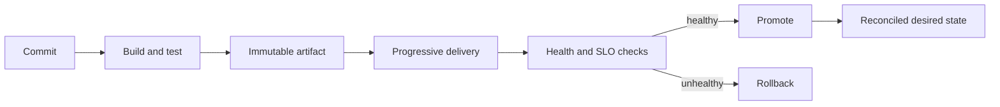

# Module 15 — DevOps & CI/CD

Learn the delivery lifecycle from a reproducible build through a monitored, reversible production release. This repository contains runnable Java 21 demonstrations for rollout and flag mechanics, plus illustrative Docker, Kubernetes, Terraform, and GitHub Actions configuration. The configurations are teaching examples—not a production platform or a deployed service.

## Topics

1. [CI/CD Pipelines](topics/ci-cd.md)
2. [Containerization (Docker)](topics/containers.md)
3. [Container Orchestration (Kubernetes)](topics/kubernetes.md)
4. [Infrastructure as Code (Terraform)](topics/infrastructure-as-code.md)
5. [Blue-Green Deployment](topics/blue-green.md)
6. [Canary Deployment](topics/canary.md)
7. [Rolling Deployment](topics/rolling.md)
8. [Feature Flags](topics/feature-flags.md)
9. [GitOps](topics/gitops.md)



## Run and validate

Requires JDK 21 (Gradle toolchains are configured for Java 21).

```bash
./gradlew clean test
python3 scripts/check_links.py
```

The tests exercise bounded canary traffic steps, reversible blue/green routing, invalid rollout input, and default-off user-targeted flags. For production, add environment-specific policy, secret management, deployment permissions, and integration tests.

## Sources

- [GitHub Actions: Understanding GitHub Actions](https://docs.github.com/en/actions/about-github-actions/understanding-github-actions)
- [Docker: Building best practices](https://docs.docker.com/build/building/best-practices/)
- [Kubernetes: Deployments](https://kubernetes.io/docs/concepts/workloads/controllers/deployment/)
- [Terraform: Recommended practices](https://developer.hashicorp.com/terraform/cloud-docs/recommended-practices)
- [OpenGitOps: Principles](https://opengitops.dev/)
