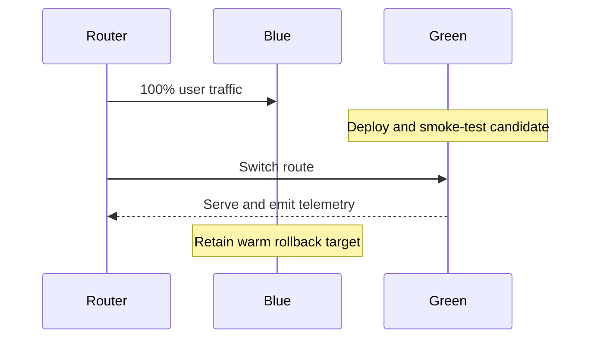

# Blue-Green Deployment

## Architecture and sequence

Run two compatible production environments. One (blue) serves traffic while the other (green) receives the candidate. Validate green before atomically moving the routing pointer; keep blue available for a quick rollback.

The [Java router example](../src/main/java/org/absolutebonkers/devops/BlueGreenRouter.java) demonstrates only an atomic active-environment pointer; the unit test verifies switching back. It is not a load balancer or production deployment controller.

## Requirements and safe operation

- Both environments need compatible configuration, capacity, network policy, and observability.
- Prefer expand-and-contract database migrations: deploy code that works with the old and new schema, migrate data, then remove obsolete schema in a later release.
- Validate candidate health with smoke, synthetic, and dependency tests before switching.
- Shift routing through a controllable, auditable mechanism; preserve connection draining, session behavior, and DNS/cache considerations.
- Define rollback trigger, operator, and time budget in advance; retain the previous release and configuration.

## Trade-offs / failure modes

Near-duplicate environments can double cost. Stateful workloads, non-backward-compatible schema changes, long-lived sessions, and external side effects complicate reversal. A traffic switch can expose hidden capacity or cache warm-up issues. Blue is not a rollback if shared state has already changed incompatibly.

## Exercise

Model a release with a schema change. Write a three-release migration plan that permits rollback after each deployment. State exactly which health signals stop promotion.

## References

- [AWS Prescriptive Guidance: Blue/green deployments](https://docs.aws.amazon.com/prescriptive-guidance/latest/strategy-database-migration/blue-green-deployments.html)
- [Google Cloud: Blue-green deployment](https://cloud.google.com/deploy/docs/deployment-strategies/blue-green)
