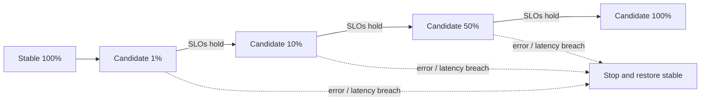

# Canary Deployment

## Idea

Expose a small, representative fraction of traffic to a new version, compare candidate behavior with a control, and increase exposure only while predefined guardrails hold. A canary is a controlled experiment, not merely “deploy to a few servers.”

The [`CanaryRollout`](../src/main/java/org/absolutebonkers/devops/CanaryRollout.java) Java sample generates bounded traffic percentage steps and has validation tests. It intentionally omits routing, statistical analysis, and automated health decisions.

## Plan

1. Choose a representative cohort and a stable control; avoid biased samples.
2. Define minimum sample/time window and guardrails before release: error rate, latency percentiles, saturation, business outcomes, and dependency health.
3. Check that telemetry can segment by version without high-cardinality labels.
4. Increase exposure in measured steps; pause long enough to observe relevant traffic and asynchronous effects.
5. Abort automatically or manually on a threshold; preserve evidence and route back to stable.

## Risks and trade-offs

Small samples miss rare errors; too many dimensions cause noisy comparisons. A user/session cohort yields consistent experience but may be biased. Mixed versions require API and data compatibility. Canarying cannot safely isolate a defect if both versions share a failing database or queue. Account for retry amplification and delayed jobs.

## Exercise

Define a canary for a checkout endpoint. Specify a control group, sample/window, metrics, stop thresholds, rollout steps, and how you will distinguish release regression from a regional dependency failure.

## References

- [Google Cloud: Canary deployment](https://cloud.google.com/deploy/docs/deployment-strategies/canary)
- [Google SRE Book: Canarying Releases](https://sre.google/workbook/canarying-releases/)
