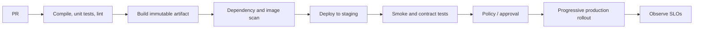

# CI/CD Pipelines

## Purpose

Continuous integration (CI) makes small changes continuously buildable and testable. Continuous delivery (CD) keeps a tested artifact releasable; continuous deployment additionally releases qualifying changes automatically. A pipeline is an auditable, repeatable state transition—not a substitute for engineering quality.

## Flow and gates

### Practical design

- Keep CI fast: format/lint, compilation, focused unit tests, then broader integration and security checks.
- Build once; promote the same content-addressed artifact through environments. Never rebuild “the same version” for production.
- Pin toolchains and dependencies, use lockfiles, retain provenance and test results, and sign artifacts where the supply chain requires it.
- Give jobs least-privilege, short-lived credentials. Do not expose production secrets to untrusted pull requests.
- Cache only reproducible inputs. Treat cache misses as normal and cache contents as untrusted.
- Make deployment steps idempotent, observable, and safe to retry. Encode rollback criteria before rollout.
- Separate source validation from deployment credentials; protect production environments and review workflow changes.

## Failure modes and trade-offs

Flaky tests erode trust; quarantine with an owner and expiry rather than silently ignoring failures. Long serial pipelines slow feedback; excessive parallelism raises cost and can hide shared-state test races. A green build is not proof of production safety: migrations, external dependencies, realistic load, and runtime configuration still need explicit validation.

## Exercise and review checklist

Design a pipeline for a Java API. Identify stages, artifact identity, cache boundaries, test pyramid, secret exposure rules, approval policy, and rollback trigger. Reviewers should be able to answer: what exact bytes are deployed, who authorized it, and how will failure be detected?

## References

- [GitHub Actions: Understanding GitHub Actions](https://docs.github.com/en/actions/about-github-actions/understanding-github-actions)
- [SLSA: Build track](https://slsa.dev/spec/v1.0/levels)
