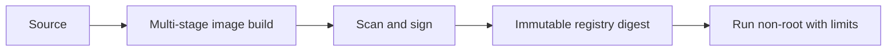

# Containerization (Docker)

## Model

A container image is an immutable filesystem and metadata bundle; a container is its isolated runtime process. Containers package an application and dependencies consistently, but share the host kernel and are not a VM or a complete security boundary.

## Example lifecycle

The repository's [`Dockerfile`](../Dockerfile) illustrates a small Java 21 runtime image. Build the jar first with `./gradlew clean test jar`; update the image tag before using the manifest. A production image should use a supported, pinned base digest and a multi-stage build to avoid shipping build tools.

## Operational and security practices

- Use `.dockerignore`; keep credentials, VCS metadata, caches, and local build output out of the build context.
- Run as a non-root user, use a minimal maintained base, patch regularly, and scan both OS and application dependencies.
- Pin the deployed image by digest; tags are convenient labels, not immutable identities.
- Do not bake secrets into layers or build arguments. Inject secrets at runtime via a managed secret provider.
- Handle SIGTERM, stop accepting work, drain requests, and exit within the orchestrator grace period.
- Set CPU/memory limits and requests at the scheduler; expose health endpoints whose semantics match readiness and liveness.

## Trade-offs and failure modes

Smaller images reduce transfer and attack surface but can complicate debugging and native-library support. A container starting successfully does not imply its dependencies are reachable. Image pulls fail on missing tags, registry auth, architecture mismatch, or rate limits; observe these distinctly from application crashes.

## Exercise

Build a Java jar, create a non-root image, inspect its layers, scan it, and run it with a read-only filesystem and explicit resource bounds. Confirm graceful shutdown and health checks.

## References

- [Docker: Building best practices](https://docs.docker.com/build/building/best-practices/)
- [Docker: Image digests](https://docs.docker.com/dhi/core-concepts/digests/)
- [OWASP: Docker Security Cheat Sheet](https://cheatsheetseries.owasp.org/cheatsheets/Docker_Security_Cheat_Sheet.html)
