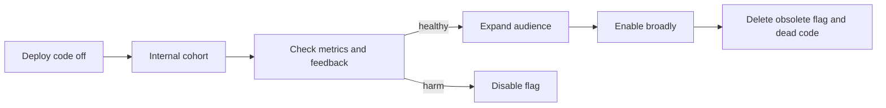

# Feature Flags

## Purpose and lifecycle

Feature flags decouple code deployment from feature exposure: release code dark, enable it for a cohort, measure behavior, then expand, disable, or remove the flag. Flags are runtime policy and need ownership, expiry, evaluation rules, and auditability.

The [Java implementation](../src/main/java/org/absolutebonkers/devops/FeatureFlags.java) is a tiny immutable user allow-list used to demonstrate default-off behavior. It does not implement remote configuration, percentage hashing, persistence, or a flag-management service.

## Good practice

- Classify release, experiment, operational kill-switch, and permission flags; do not use a rollout flag as authorization.
- Default safely when evaluation/configuration is unavailable; make fallback behavior explicit.
- Keep flag checks deterministic for a request/session and avoid fetching remote config synchronously on every request.
- Secure flag administration, audit changes, test both branches, and prevent sensitive targeting attributes from leaking into logs.
- Assign an owner and removal date. Track stale flags and remove branches after rollout.

## Risks / trade-offs

Flag combinations multiply test states and may preserve unreachable code. A global kill switch can itself become a critical dependency. Remote updates can be inconsistent across instances. Feature flags do not replace access control, and a disabled feature can still expose a vulnerable endpoint if authorization is weak.

## Exercise

Propose a kill switch and gradual rollout for a new search ranking. Include fallback, cohort consistency, observability, permissions, and retirement criteria.

## References

- [Martin Fowler: Feature Toggles](https://martinfowler.com/articles/feature-toggles.html)
- [OpenFeature: Specification](https://openfeature.dev/specification/)
