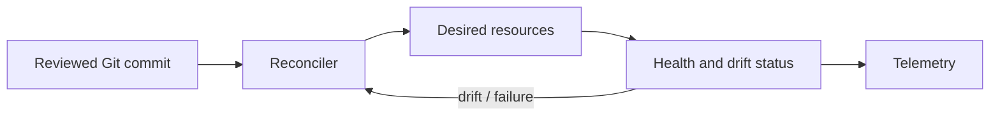

# GitOps

## Model

GitOps uses version-controlled desired state and an automated reconciler to continuously compare and correct deployed state. A commit is a desired-state change; the controller's observed status tells whether that intent converged.

## Operating principles

- Make Git the reviewed source of desired state and separate application artifacts from environment configuration.
- Use reconciliation rather than imperative, one-shot scripts where feasible.
- Restrict controller permissions by namespace/resource; protect credentials and isolate tenants.
- Pin image digests and dependencies, apply policy checks, and protect branches/environments.
- Detect drift and surface reconciliation errors, age, retries, and health; avoid controllers silently fighting manual changes.
- Define rollback as a new reviewed desired state, or a deliberate revert with awareness of migrations and irreversible effects.

## Trade-offs and failure modes

Git history provides auditability, but only if commits are trusted and access is protected. A controller outage delays changes but should not necessarily stop existing workloads. Secret material must not be committed in plaintext. Reconciliation can reapply an unsafe declaration just as reliably as a safe one. Avoid circular ownership between multiple controllers.

## Exercise

Describe the Git repositories, promotion flow, secret handling, RBAC boundaries, drift policy, emergency break-glass procedure, and rollback method for three environments.

## References

- [OpenGitOps: Principles](https://opengitops.dev/)
- [Flux: GitOps principles](https://fluxcd.io/flux/concepts/)
