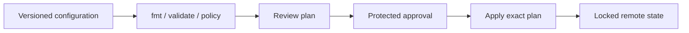

# Infrastructure as Code (Terraform)

## Workflow

Terraform describes infrastructure as configuration, compares desired state with provider-observed state, and proposes changes before applying. Treat plans and state as sensitive operational artifacts.

[`terraform/main.tf`](../terraform/main.tf) is a provider-free `terraform_data` example to make plan/apply mechanics tangible; it does not create cloud infrastructure. The root [Terraform guide](../README.md) explicitly avoids implying that it provisions a production environment.

## Practices

- Use remote state with encryption, access control, locking, backups, and recovery drills. Never commit state or credentials.
- Pin Terraform and provider versions; review provider upgrade diffs and commit dependency lockfiles.
- Separate environments and ownership boundaries deliberately; avoid one state file for unrelated teams or blast radii.
- Run `fmt`, `validate`, security/policy checks, and plan review in CI. Apply the reviewed plan, not an unreviewed recomputation.
- Model dependencies declaratively; avoid provisioners when provider resources or configuration management fit better.
- Import existing resources carefully and detect drift; `plan` output can reveal destructive changes.
- Keep secrets out of source and plan output; mark variables sensitive and still assume state may contain secrets.

## Failure modes / trade-offs

Concurrent applies without locking can corrupt state or race. State loss can orphan resources; state exposure can disclose secrets. Abstraction modules improve reuse but can hide complexity. Plan files go stale as real infrastructure changes; re-plan under an approval flow.

## Exercise

Run `terraform init`, `terraform fmt -check`, `terraform validate`, and `terraform plan -var environment=dev` in this directory. Inspect the plan and state locally, then destroy the example. Do not use production credentials.

## References

- [Terraform: Recommended practices](https://developer.hashicorp.com/terraform/cloud-docs/recommended-practices)
- [Terraform: State](https://developer.hashicorp.com/terraform/language/state)
- [Terraform: Sensitive data](https://developer.hashicorp.com/terraform/language/manage-sensitive-data)
