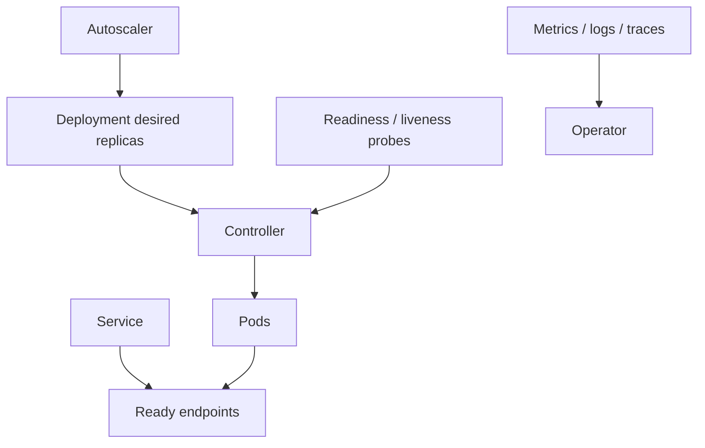

# Container Orchestration (Kubernetes)

## What orchestration provides

Kubernetes continuously reconciles declared resources toward desired state: scheduling, restart behavior, service discovery, scaling primitives, and rollout controls. It does not automatically make an application stateless, secure, highly available, or correctly sized.

The sample [`Deployment` and `Service`](../deploy/kubernetes/deployment.yaml) include three replicas, resource requests/limits and HTTP probes. Replace its placeholder image, configure namespace and security context, and validate with the policy checks used by your cluster before applying.

## Design checklist

- Choose Deployment for stateless replicated workloads; use StatefulSet only when stable identity/storage semantics are needed.
- Set meaningful requests and limits; understand CPU throttling, memory OOM behavior, and cluster capacity.
- Readiness removes a pod from serving endpoints; liveness restarts a stuck process; startup probes protect slow initialization.
- Use rolling updates with `maxUnavailable`/`maxSurge` appropriate to capacity and availability requirements.
- Apply pod security standards, non-root execution, least-privilege service accounts, network policies, and secret encryption/access controls.
- Add disruption budgets, autoscaling, topology spread/anti-affinity, and resource quotas based on failure-domain and workload goals.
- Keep state and durable work outside ephemeral pod filesystems; graceful termination must stop new work and drain in-flight requests.

## Failure modes and observability

Pending pods may indicate insufficient resources, affinity constraints, or quota; CrashLoopBackOff may indicate app startup/config errors; readiness failure may be a dependency outage rather than a bad container. Correlate deployment events, pod restarts, scheduling events, request SLOs, saturation, and dependency health.

## Exercise

Deploy a stateless service into a disposable cluster. Force a bad image, capacity shortage, and failing readiness endpoint; diagnose using events and metrics. Test rollout pause, rollback, and graceful drain.

## References

- [Kubernetes: Deployments](https://kubernetes.io/docs/concepts/workloads/controllers/deployment/)
- [Kubernetes: Probes](https://kubernetes.io/docs/concepts/configuration/liveness-readiness-startup-probes/)
- [Kubernetes: Pod Security Standards](https://kubernetes.io/docs/concepts/security/pod-security-standards/)
